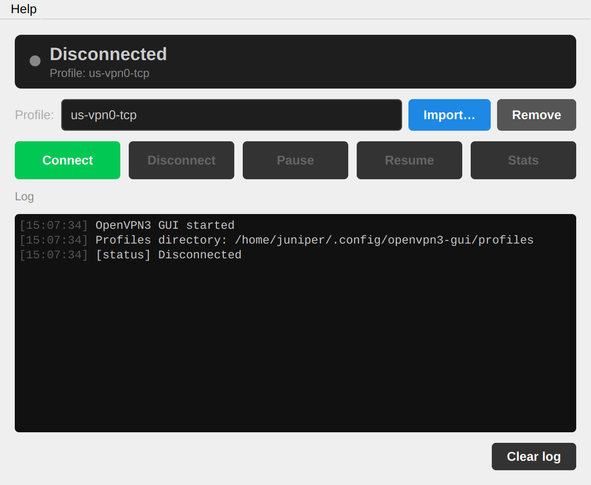
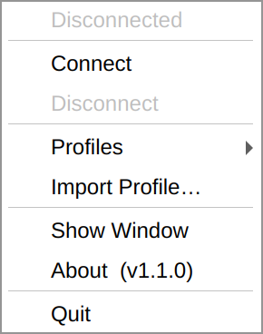

# OpenVPN3 GUI

A PyQt5 desktop client and system tray icon for the [`openvpn3`](https://github.com/OpenVPN/openvpn3-linux) CLI. Supports multiple profiles, session management, and runs persistently in the system tray. Also ships a full-featured CLI (`openvpn3-cli`) for headless and scripted use.

## Screenshots

| Main window | Tray menu |
|:-----------:|:---------:|
|  |  |

## Features

- System tray icon with colour-coded connection status
- Import and manage multiple `.ovpn` profiles
- Connect, disconnect, pause, and resume sessions
- View live session statistics
- Minimises to tray on close; right-click to quit
- Cleans up orphaned sessions and stale app instances on startup
- **Start on Login** — toggle autostart via tray menu or Settings menu bar; launches straight to tray
- **Connect on Login** — auto-connect to a saved profile on boot (enable via Settings or tray menu)
- **CLI (`openvpn3-cli`)** for headless, scripted, or terminal-first use

## Requirements

- Python 3.10+
- ARM64 (`aarch64`) or x86_64 (`amd64`) Linux with a desktop session
- An apt- or dnf-based distribution supported by the OpenVPN 3 installer
- `sudo` access to install system packages, and internet access to package repositories and PyPI

The installer installs `pipx`, the distribution's native PyQt5 package, and
[`openvpn3`](https://community.openvpn.net/Pages/OpenVPN3Linux) if missing.
OpenVPN's upstream ARM64 packages are currently described as tech-preview.

## Installation

```bash
git clone https://github.com/invaliddev403/openvpn3-gui
cd openvpn3-gui
./install.sh
```

Run the installer as your normal desktop user, without `sudo`; it requests
privileges for system packages as needed. Ubuntu 22.04, 24.04, 25.10, 26.04,
Debian 12/13, Zorin OS 18, Fedora and RHEL are handled by the backend installer
(repository/package availability still depends on the release).

The installer:
- Runs `install-openvpn3.sh` if the OpenVPN 3 backend is missing
- Installs the native Qt/XCB libraries required by PyQt5
- Cleans up legacy installations (`~/.local/lib/openvpn3-gui`)
- Installs the app via `pipx` using `/usr/bin/python3` and `--system-site-packages`, so both ARM64 and x86_64 use the distribution's native PyQt5 rather than needing a PyPI Qt wheel or a source build
- Checks GUI/CLI and Qt imports and runs `pipx ensurepath` for both `openvpn3-gui` and `openvpn3-cli` (a new terminal may be needed)
- Installs **OpenVPN3 GUI** in the applications menu under Network, using
  `${XDG_DATA_HOME:-~/.local/share}/applications` and the installed pipx executable
- Copies any bundled `.ovpn` files into the profiles directory with secure permissions
- Fixes the autostart entry (`~/.config/autostart/openvpn3-gui.desktop`) if it exists but is missing the `--minimized` flag
- Applies the desktop session watcher startup fix when the upstream helper is installed (see below)

Make sure `~/.local/bin` is in your `PATH`, then launch the GUI:

```bash
openvpn3-gui
```

To install only the OpenVPN 3 backend, run `./install-openvpn3.sh`.
32-bit ARM and 32-bit x86 are not supported by this installation path.

Or use the CLI directly:

```bash
openvpn3-cli --help
```

### Upgrading

Re-run `./install.sh` — it recreates the app's `pipx` environment to migrate older
installs to the system Python and native Qt packages. User profiles and settings
are kept outside that environment and are preserved.

### Desktop notification startup fix

Some desktops start OpenVPN's `openvpn3-desktop-session-watcher` before the
notification service is ready. The installer includes a wrapper that waits for
`org.freedesktop.Notifications` before starting the upstream watcher. D-Bus or
runtime failures exit through Python with status 1, allowing systemd to retry
after 15 seconds without generating an unhandled Python crash report.

The fix is installed only when `/usr/bin/openvpn3-desktop-session-watcher`
exists. It requires the system Python's `dbus` module and an available systemd
user manager. Run the installer from your desktop login session. To apply only
this fix, run:

```bash
./desktop-fixes/install.sh
```

It installs `~/.local/libexec/openvpn-session-watcher.py` and a user service
override at
`~/.config/systemd/user/openvpn3-desktop-session-watcher.service.d/desktop-startup.conf`.
An existing override is backed up before replacement. Only the notification
watcher service is restarted; VPN sessions are left running. Existing crash
reports are preserved.

To remove the workaround and return to the upstream service configuration:

```bash
rm ~/.config/systemd/user/openvpn3-desktop-session-watcher.service.d/desktop-startup.conf
systemctl --user daemon-reload
systemctl --user restart openvpn3-desktop-session-watcher.service
rm ~/.local/libexec/openvpn-session-watcher.py
```

## CLI usage

`openvpn3-cli` provides a subcommand-style interface. Profiles are shared with the GUI.

```
Commands:
  status              Show current VPN session status
  list  (ls)          List available profiles
  connect <profile>   Connect to a profile
  disconnect (down)   Disconnect the active session
  pause               Pause the active session
  resume              Resume a paused session
  stats               Show session statistics
  import <file.ovpn>  Import a profile
  remove <profile>    Remove a profile
```

Profiles can be identified by name, a case-insensitive substring, or their list number from `openvpn3-cli list`.

```bash
openvpn3-cli list
openvpn3-cli connect work-vpn       # by name
openvpn3-cli connect 1              # by list number
openvpn3-cli status
openvpn3-cli disconnect
openvpn3-cli import ~/corp.ovpn --name "Corp VPN"
openvpn3-cli remove "Corp VPN" --yes
openvpn3-cli stats
```

### Web-based authentication (Authentik, SSO)

If your VPN uses web-based authentication (e.g. Authentik with Google login), `openvpn3-cli connect` handles it automatically:

1. The auth URL is printed clearly in the terminal
2. Open the URL in a browser on **any device** (your laptop, phone, etc.)
3. Complete login — the CLI keeps polling and prints `Connected.` once the server confirms auth

No input is needed back in the terminal. CLI browsers (`w3m`, `lynx`) will not work for Google OAuth as they do not support JavaScript.

## Profile management

Profiles are stored in `~/.config/openvpn3-gui/profiles/` and are shared between the GUI and CLI.

| Action | GUI | CLI |
|--------|-----|-----|
| Import | `Import…` button or tray → `Import Profile…` | `openvpn3-cli import <file.ovpn>` |
| Switch | Dropdown or tray `Profiles` submenu | `openvpn3-cli connect <name>` |
| Remove | `Remove` button | `openvpn3-cli remove <name>` |

## Project structure

```
openvpn3-gui/
├── vpn_gui.py            # GUI application (PyQt5)
├── vpn_cli.py            # CLI application
├── openvpn3-gui.desktop  # Desktop entry (template)
├── install.sh            # Installer / upgrade script
├── install-openvpn3.sh   # OpenVPN 3 backend installer
├── desktop-fixes/        # Notification watcher wrapper and installer
└── .gitignore            # Excludes *.ovpn files
```

## Version

Current version is defined in `vpn_gui.py`:

```python
APP_VERSION = "1.3.0"
```
